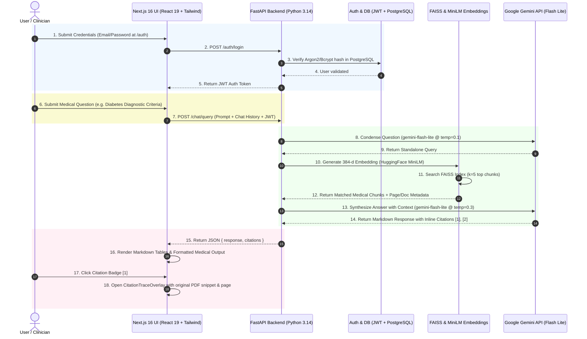
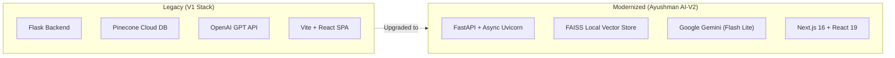

# Ayushman AI-V2 - Complete Project Overview & Tech Stack Guide

## 📌 1. Executive Summary
**Ayushman AI-V2** is a factual, RAG-grounded healthcare reference assistant. It combines modern web technologies with Retrieval-Augmented Generation (RAG) to provide verified clinical information based on an indexed medical dataset.

The system utilizes **FAISS** for fast vector search over PDF medical documents, **HuggingFace MiniLM embeddings** for semantic representations, **Google Gemini (`gemini-flash-lite-latest`)** for clinical response generation, and **FastAPI + Next.js 16** for a performant, responsive end-user experience.

---

## 🔄 2. Complete End-to-End User Workflow & Sequence Diagram

The diagram below illustrates the exact step-by-step path from when a user interacts with the UI to database verification, vector search, LLM inference, and citation rendering.



---

### 📑 Step-by-Step Technical Execution Mechanics

#### 🔑 Step 1: User Authentication & Access Control
1. **User Action**: The user visits `http://localhost:3000/auth` and submits email and password.
2. **Frontend Engine**: Built with **Next.js 16 App Router** ([`src/app/auth/page.tsx`](file:///Users/bhabanishankarpanda/Projects/Python/Ayushman%20AI-V2/frontend/src/app/auth/page.tsx)), **React 19**, and **shadcn/ui**. Form submission dispatches an asynchronous HTTP request.
3. **Backend Server**: **FastAPI** ([`backend/app/routers/auth.py`](file:///Users/bhabanishankarpanda/Projects/Python/Ayushman%20AI-V2/backend/app/routers/auth.py)) handles request routing, validating inputs with **Pydantic v2**.
4. **Database & Hashing**: **SQLAlchemy 2.0** queries **PostgreSQL** ([`backend/app/core/database.py`](file:///Users/bhabanishankarpanda/Projects/Python/Ayushman%20AI-V2/backend/app/core/database.py)), verifying password hashes with **Argon2 / Bcrypt**.
5. **Token Generation**: **PyJWT** generates an access token returned to the browser for persistent session state.

#### 📄 Step 2: Background Vector Ingestion (Offline/Pre-Index Stage)
1. **Document Loading**: **`pypdf`** ([`pdf_loader.py`](file:///Users/bhabanishankarpanda/Projects/Python/Ayushman%20AI-V2/backend/app/services/pdf_loader.py)) parses medical textbooks in `backend/data/` (e.g. *Harrison General Medicine.pdf*, *NICE Guidelines.pdf*).
2. **Semantic Chunking**: LangChain `RecursiveCharacterTextSplitter` splits text into 1,000-character chunks with 200-character overlap while preserving page numbers and document titles.
3. **Embedding Generation**: **HuggingFace MiniLM (`sentence-transformers/all-MiniLM-L6-v2`)** converts chunks into 384-dimensional dense vectors on CPU.
4. **Vector Indexing**: **FAISS (`faiss-cpu`)** creates `index.faiss` and saves file tracking metadata to `indexed_files.json` ([`vector_store.py`](file:///Users/bhabanishankarpanda/Projects/Python/Ayushman%20AI-V2/backend/app/services/vector_store.py)).

#### 💬 Step 3: User Query Submission
1. **User Action**: Clinician enters a query into the chat interface ([`ChatWorkspace.tsx`](file:///Users/bhabanishankarpanda/Projects/Python/Ayushman%20AI-V2/frontend/src/modules/chat/ChatWorkspace.tsx)).
2. **UI Interactivity**: **Framer Motion** animates message appearance, and **Lucide React** renders status indicators.
3. **API Dispatch**: Next.js sends JSON payload `{ question, history }` to FastAPI.

#### 🔄 Step 4: Conversation Condensation (RAG Phase 1)
1. **Condensation Chain**: **`rag_chain.py`** checks for active chat history.
2. **LLM Query Rephrasing**: Calls **Google Gemini API (`gemini-flash-lite-latest`)** at `temperature=0.1` to rephrase ambiguous follow-up questions into standalone queries (e.g., converting *"What are its dosages?"* into *"What are the dosage guidelines for Metformin in Type 2 Diabetes?"*).

#### 🎯 Step 5: Vector Similarity Search & Context Retrieval (RAG Phase 2)
1. **Query Encoding**: HuggingFace MiniLM vectorizes the condensed query string.
2. **FAISS Search**: Performs dense vector search against the local FAISS index to retrieve top $k=5$ matching document chunks.
3. **Metadata Association**: Captures raw text content along with metadata tags: `page`, `sourceDoc`, and snippet indices.

#### 🩺 Step 6: Grounded Synthesis & Formatting (RAG Phase 3)
1. **Prompt Injection**: Constructs `SYSTEM_PROMPT_TEMPLATE` with retrieved context and history.
2. **Clinical Rules Enforcement**:
   * Direct main heading start (`### HEADING`).
   * Concise 2-line introductory summary.
   * Markdown tables for dosages, staging, or criteria.
   * Markdown blockquotes for warnings (`> **Clinical Note:**`).
   * Inline citation tags (`[1]`, `[2]`).
3. **Gemini Execution**: **Google Gemini (`gemini-flash-lite-latest`)** generates the response at `temperature=0.3`.

#### 🔍 Step 7: Response Rendering & Citation Inspection
1. **Markdown Parsing**: **`react-markdown`** & **`remark-gfm`** compile the response into styled HTML tables and text.
2. **Citation Overlay**: Clicking citation tags (`[1]`, `[2]`) triggers **[`CitationTraceOverlay.tsx`](file:///Users/bhabanishankarpanda/Projects/Python/Ayushman%20AI-V2/frontend/src/components/CitationTraceOverlay.tsx)**, displaying a slide-over panel with the exact original PDF page snippet and textbook metadata.

---

## 🛠️ 3. High-Level Tech Stack At A Glance

### 🎨 Frontend
* **Framework**: Next.js 16 (App Router Architecture)
* **Library**: React 19 & React DOM 19
* **Language**: TypeScript 5
* **Styling**: Tailwind CSS v4, PostCSS, shadcn/ui, `clsx`, `tailwind-merge`
* **Animations & Graphics**: Framer Motion, GSAP, Canvas/WebGL Effects (`SplashCursor`)
* **Icons & Rendering**: `lucide-react`, `react-markdown`, `remark-gfm`

### ⚙️ Backend & Database
* **Runtime & Server**: Python 3.14 + FastAPI + Uvicorn (`uvloop`)
* **Data Validation**: Pydantic v2 & `pydantic-settings`
* **Database & ORM**: PostgreSQL + SQLAlchemy 2.0 ORM + `psycopg2-binary`
* **Security & Auth**: `PyJWT`, `argon2-cffi`, `bcrypt`, `passlib`

### 🧠 AI, RAG & Vector Engine
* **LLM Engine**: Google Gemini API (`gemini-flash-lite-latest`)
* **Vector Store**: FAISS (`faiss-cpu`)
* **Embeddings Model**: HuggingFace `sentence-transformers/all-MiniLM-L6-v2`
* **Orchestration**: `langchain`, `langchain-community`, `langchain-core`, `langchain-google-genai`, `langgraph`
* **Document Processing**: `pypdf` + LangChain `RecursiveCharacterTextSplitter`

---

## 📂 4. Detailed File Structure & Vertical Tree Architecture Diagram

### 🗺️ Vertical Directory Tree Diagram

```mermaid
graph TD
    Root["📁 Ayushman AI-V2 Root"]
    
    %% Vertical Branch to Backend
    Root --> Backend["📂 backend/"]
    Backend --> App["📂 app/"]
    Backend --> Data["📂 data/ (Medical Textbooks PDFs)"]
    Backend --> VectorStore["📂 vector_store/ (FAISS Index Binary Files)"]
    Backend --> Ingest["📄 ingest.py (CLI Indexer)"]
    Backend --> Bench["📄 benchmark.py (RAG Benchmark)"]
    
    App --> Main["📄 main.py (FastAPI App)"]
    App --> Config["📄 config.py (Pydantic Settings)"]
    App --> Core["📂 core/ (security/ & database.py Engine)"]
    App --> DB["📂 db/ (models/ user.py, schema/, repository/)"]
    App --> Services["📂 services/ (AI & RAG Pipeline)"]
    App --> Routers["📂 routers/ (auth.py Endpoints)"]

    Services --> PDFLoader["📄 pdf_loader.py (PDF Chunking Engine)"]
    Services --> VectorStoreService["📄 vector_store.py (FAISS Index Manager)"]
    Services --> RAGChain["📄 rag_chain.py (Gemini & Prompt Chain)"]

    Routers --> AuthRouter["📄 auth.py (Login/Register)"]

    %% Vertical Branch to Frontend
    Root --> Frontend["📂 frontend/"]
    Frontend --> AppRouter["📂 src/app/ (Next.js 16 App Router)"]
    Frontend --> Modules["📂 src/modules/"]
    Frontend --> Components["📂 src/components/"]
    Frontend --> ReactBits["📂 src/react-bits/ (WebGL Effects)"]

    AppRouter --> PageLanding["📄 page.tsx (Landing Page '/')"]
    AppRouter --> PageChat["📄 chat/page.tsx (AI Workspace '/chat')"]
    AppRouter --> PageAuth["📄 auth/page.tsx (Auth UI '/auth')"]

    Modules --> ModChat["📂 chat/ (Chat Workspace)"]
    Modules --> ModAuth["📂 auth/ (Login/Signup Forms)"]
    Modules --> ModLanding["📂 landing/ (Hero Showcase)"]
    Modules --> ModLayout["📂 layout/ (Navbar & Sidebar)"]

    Components --> UIComp["📂 ui/ (shadcn Primitives)"]
    Components --> CitationOverlay["📄 CitationTraceOverlay.tsx (Source Overlay)"]
```



---

### 🔍 Deep Dive: Backend Component Responsibilities

#### 1. Core Application Setup
* **`backend/app/main.py`**: The entry point for the FastAPI server. Configures CORS middleware, mounts API routers (`/auth`), and initializes startup events.
* **`backend/app/config.py`**: Uses `pydantic-settings` to load environment variables from `.env` (Gemini API keys, PostgreSQL database URLs, vector directory settings).

#### 2. Database & Security Layer (`backend/app/core/` & `backend/app/db/`)
* **`backend/app/core/database.py`**: Establishes the SQLAlchemy engine connection to PostgreSQL and provides the `get_db()` session dependency.
* **`backend/app/core/security/`**:
  * `hashHelper.py`: Wraps password hashing (`bcrypt` / `argon2`) for user passwords.
  * `authHandler.py`: Manages JWT token generation, expiration, and payload decoding.
* **`backend/app/db/models/user.py`**: Defines the `User` database table model (id, email, password_hash, created_at).
* **`backend/app/db/schema/user.py`**: Defines Pydantic validation schemas (`UserCreate`, `UserLogin`, `UserResponse`).
* **`backend/app/db/repository/userRepo.py`**: Data Access Layer providing methods to query, insert, and update user records in PostgreSQL.

#### 3. AI & RAG Pipeline (`backend/app/services/`)
* **`pdf_loader.py`**: Scans PDF documents, extracts text using `pypdf`, and chunks content via LangChain's `RecursiveCharacterTextSplitter` while capturing page numbers and document titles.
* **`vector_store.py`**: 
  * Loads HuggingFace MiniLM sentence embeddings.
  * Manages FAISS vector indexing.
  * Checks modification timestamps of files in `backend/data/` and performs incremental indexing or full index rebuilds.
  * Saves metadata to `backend/vector_store/indexed_files.json`.
* **`rag_chain.py`**:
  * **Question Condensation**: Rephrases conversational follow-up questions into standalone queries using `condensation_llm` (`temperature=0.1`).
  * **Vector Similarity Search**: Queries FAISS to retrieve top matching medical context chunks ($k=5$).
  * **Grounded Generation**: Passes retrieved medical context and history into Google Gemini (`gemini-flash-lite-latest`) with clinical prompt formatting rules.

#### 4. Executables & Medical Dataset
* **`backend/ingest.py`**: Command-line script to trigger manual indexing of medical textbooks.
* **`backend/benchmark.py`**: Benchmarks RAG response accuracy and retrieval precision.
* **`backend/data/`**: Stores domain-specific medical textbooks organized in subfolders (`Clinical guidelines/`, `Emergency Medicine/`, `First Aid/`, `General Medicine/`, `Laboratory Medicine/`, `Pharmocology/`).
* **`backend/vector_store/`**: Contains generated FAISS index files (`index.faiss`, `index.pkl`, `indexed_files.json`).

---

### 🎨 Deep Dive: Frontend Component Responsibilities

#### 1. Next.js App Router (`frontend/src/app/`)
* **`layout.tsx`**: Main HTML shell setting up global fonts, Tailwind CSS stylesheets, and theme context providers.
* **`page.tsx`**: Renders the public landing page route (`/`).
* **`chat/page.tsx`**: Route handler for the interactive AI healthcare assistant workspace (`/chat`).
* **`auth/page.tsx`**: Route handler for user login and signup interfaces (`/auth`).
* **`sandbox/page.tsx`**: Dedicated playground for testing individual UI components in isolation (`/sandbox`).

#### 2. Domain Modules (`frontend/src/modules/`)
* **`modules/chat/`**: Houses `ChatWorkspace.tsx` and components for rendering chat messages, active citations, and vector context inspection.
* **`modules/auth/`**: Houses `LoginPage.tsx`, `SignupPage.tsx`, and `LoginSignUp.tsx` form handling components.
* **`modules/landing/`**: Houses hero banners, feature showcases, and interactive medical assistant highlights.
* **`modules/layout/`**: Shared navigation components (`Navbar.tsx`, `sidebar.tsx`).

#### 3. Custom UI & Interactive Overlays (`frontend/src/components/`)
* **`components/CitationTraceOverlay.tsx`**: Specialized overlay that highlights exact PDF source pages and text snippets retrieved by FAISS for a specific LLM citation tag (e.g. `[1]`, `[2]`).
* **`components/ui/`**: Reusable shadcn component primitives (`accordion`, `sheet`, buttons, dialogs).
* **`src/react-bits/`**: Advanced WebGL and canvas visual effects (`SplashCursor.jsx`, `SplitText.tsx`, `PillNav.tsx`).

---

## 🔬 5. Detailed Tech Stack Definitions, Rationale & Alternatives



### 1. Web Backend Framework
* **Current Stack**: **FastAPI + Uvicorn (ASGI) + Pydantic v2**
* **Definition**: FastAPI is a modern, high-performance Python web framework for building APIs based on standard Python type hints.
* **Why it was used in V2**:
  * **Native Async Support**: Powered by `async/await` and `uvloop` for high concurrent request throughput.
  * **Automatic Documentation**: Automatically generates interactive OpenAPI (Swagger UI) docs.
  * **Data Validation**: Pydantic v2 provides fast, typed input validation for chat requests and user payload schemas.
* **Alternatives & V1 Comparison**:
  * 🔴 **Flask** *(Used in V1)*: Synchronous by default, requiring WSGI servers (Gunicorn) and extra libraries for Swagger docs and data validation.
  * 🟡 **Django**: Heavyweight with built-in ORM and Admin UI, but slower and overly opinionated for pure API/RAG backends.
  * 🟡 **Express.js (Node.js)**: Fast and asynchronous, but splitting AI/ML logic across Node and Python adds system complexity.

---

### 2. LLM Engine & Provider
* **Current Stack**: **Google Gemini (`gemini-flash-lite-latest`) via `langchain-google-genai`**
* **Definition**: A multimodal state-of-the-art LLM optimized for speed, factual reasoning, and large context windows.
* **Why it was used in V2**:
  * **Speed & Cost Efficiency**: Extremely low latency for real-time user query response generation.
  * **Temperature Tuning**: Configured with `temperature=0.1` for question condensation (query reframing) and `0.3` for factual grounded medical synthesis.
  * **Structured Formatting**: Follows markdown, table formatting, and strict medical intent rules without hallucinating filler text.
* **Alternatives & V1 Comparison**:
  * 🔴 **OpenAI GPT-4 / GPT-3.5 Turbo** *(Used in V1)*: High accuracy, but significantly higher API costs and strict rate limits for high-volume deployments.
  * 🟡 **Anthropic Claude 3.5 Sonnet / Haiku**: Excellent clinical reasoning and long-form writing, but slightly higher pricing compared to Gemini Flash models.
  * 🟡 **Local Open-Source LLMs (Llama 3, Mistral, Med-PaLM)**: Complete privacy and zero API key dependency, but requires dedicated GPU server hardware.

---

### 3. Vector Database & Retrieval Engine
* **Current Stack**: **FAISS (`faiss-cpu`)**
* **Definition**: Facebook AI Similarity Search (FAISS) is an open-source library for efficient dense vector similarity search and clustering.
* **Why it was used in V2**:
  * **Zero Cloud Latency & Cost**: Runs locally on CPU/memory without external cloud network roundtrips or monthly subscription costs.
  * **Local Persistence**: Saves index files (`index.faiss`) and metadata registries (`indexed_files.json`) directly to disk.
  * **Incremental Updating**: Seamlessly updates or rebuilds vectors dynamically when PDFs are added, modified, or deleted.
* **Alternatives & V1 Comparison**:
  * 🔴 **Pinecone DB** *(Used in V1)*: Fully managed cloud vector database. While easy to scale, it requires external network requests, API keys, and incurs ongoing SaaS billing.
  * 🟡 **ChromaDB**: Popular open-source embedded vector database with metadata filtering, though slightly heavier than raw FAISS.
  * 🟡 **pgvector**: PostgreSQL extension allowing vector storage inside the main SQL database. Great for unified data management, but requires PostgreSQL server setup with vector extension enabled.
  * 🟡 **Qdrant / Milvus**: Production-grade enterprise vector databases for multi-tenant hybrid search.

---

### 4. Text Embeddings Model
* **Current Stack**: **HuggingFace MiniLM (`sentence-transformers/all-MiniLM-L6-v2`)**
* **Definition**: A compact Transformer model that converts raw text snippets into 384-dimensional dense vector representations.
* **Why it was used in V2**:
  * **Local Execution**: Embeddings are computed locally on CPU without rate limits or cloud API costs.
  * **Optimal Balance**: Outstanding balance of semantic accuracy and fast inference speed.
* **Alternatives & V1 Comparison**:
  * 🔴 **OpenAI `text-embedding-ada-002` / `text-embedding-3-small`** *(Used in V1)*: High semantic quality, but incurs per-chunk API costs during PDF ingestion and query time.
  * 🟡 **BGE-Large / E5-large**: Higher retrieval accuracy benchmark scores, but requires significantly more RAM and CPU/GPU compute during indexing.
  * 🟡 **Cohere Embed v3**: Superior for multilingual documents and complex domain reranking, but relies on a paid third-party API.

---

### 5. Orchestration Framework & RAG Pipeline
* **Current Stack**: **LangChain Core + LangGraph**
* **Definition**: A developer framework for assembling LLM workflows, prompt management, document chunking, and stateful agentic graphs.
* **Why it was used in V2**:
  * **Modular RAG Pipeline**: Standardized abstraction for prompt templates, document retrievers, and history condensation.
  * **LangGraph Integration**: Prepared for multi-agent capabilities, citation overlays, and stateful decision loops.
* **Alternatives & V1 Comparison**:
  * 🔴 **Raw Custom Python RAG Pipeline** *(Used in V1)*: Direct HTTP requests to LLM APIs with custom context formatting. Simple to write initially, but harder to maintain state, history condensation, and multi-retriever logic.
  * 🟡 **LlamaIndex**: Specialized framework specifically tailored for data ingestion, advanced indexing structures, and document agents.
  * 🟡 **Haystack by Deepset**: Production-grade NLP framework focused on enterprise search pipelines.

---

### 6. Relational Database & ORM
* **Current Stack**: **PostgreSQL + SQLAlchemy 2.0**
* **Definition**: PostgreSQL is an enterprise-grade SQL database; SQLAlchemy is Python’s standard SQL toolkit and Object-Relational Mapper.
* **Why it was used in V2**:
  * **Data Integrity**: Enforces strict schemas and transactional safety for user authentication, password hashes, and chat sessions.
  * **SQLAlchemy 2.0**: Typed session management with support for asynchronous queries (`asyncpg`).
* **Alternatives & V1 Comparison**:
  * 🔴 **SQLite** *(Used in early V1 MVP)*: Single-file database, simple to start, but locks up under concurrent write operations and lacks robust user management scalability.
  * 🟡 **MongoDB / PyMongo**: NoSQL document store, excellent for flexible JSON objects, but lacks strict relational constraints for user auth tables.

---

### 7. Frontend Web Framework
* **Current Stack**: **Next.js 16 (App Router) + React 19 + TypeScript 5**
* **Definition**: A full-stack React framework enabling server-side rendering, routing, and modern frontend design.
* **Why it was used in V2**:
  * **App Router**: Clean directory-based routing (`/chat`, `/auth`, `/sandbox`).
  * **TypeScript 5**: Strong compile-time type safety preventing runtime null pointer exceptions.
  * **React 19**: Support for modern React features, concurrent rendering, and fast UI updates.
* **Alternatives & V1 Comparison**:
  * 🔴 **Vite + React SPA** *(Used in V1)*: Pure client-side single page application. Fast build times, but lacks server-side rendering, layout optimization, and unified API route capabilities.
  * 🟡 **Vue 3 / Nuxt.js**: Highly reactive framework, but React has a larger ecosystem for AI/chat component libraries.
  * 🟡 **HTML + Jinja2 (Server Templates)**: Standard server-side rendering, but lacks modern dynamic component re-rendering and fluid animations.

---

### 8. UI Components, Styling & Animation
* **Current Stack**: **Tailwind CSS v4 + shadcn/ui + Framer Motion + GSAP**
* **Definition**: A modern design stack combining utility-first CSS, accessible headless UI primitives, and hardware-accelerated animation engines.
* **Why it was used in V2**:
  * **Tailwind CSS v4**: Zero-runtime CSS with utility classes for dark mode and responsive layouts.
  * **shadcn/ui**: Copy-paste accessible components built on Radix primitives.
  * **Framer Motion & GSAP**: Enables rich visual overlays, citation overlays, fluid page transitions, and WebGL cursor effects.
* **Alternatives & V1 Comparison**:
  * 🔴 **Bootstrap / Custom CSS** *(Used in V1)*: Traditional CSS files or opinionated components. Harder to customize and lacks dynamic utility workflows.
  * 🟡 **Material UI (MUI) / Chakra UI**: Full-featured UI component libraries, but incur runtime CSS-in-JS performance overhead.

---

### 9. Document Parsing & Text Chunking
* **Current Stack**: **`pypdf` + LangChain Text Splitters**
* **Definition**: Python libraries for extracting raw text from PDF files and splitting long texts into overlapping semantic chunks.
* **Why it was used in V2**:
  * **Chunking Strategy**: Uses recursive character splitting to break documents by paragraphs while maintaining context continuity.
  * **Page Tracking**: Retains page numbers and file source metadata for citation overlay generation.
* **Alternatives & V1 Comparison**:
  * 🔴 **PyPDF2 / Simple String Splitting** *(Used in V1)*: Basic PDF reading with fixed character length splitting. Often cut sentences in half, causing broken embeddings.
  * 🟡 **Unstructured.io / PyMuPDF (FitZ)**: Advanced layout-aware parsers that detect tables, headers, and images.
  * 🟡 **OCR Engines (Tesseract / AWS Textract)**: Essential if processing scanned medical images or un-searchable PDFs.

---

## 📊 6. Summary V1 vs V2 Comparison Matrix

| Component Category | Ayushman AI V1 | Ayushman AI V2 | Primary Reason for Change |
| :--- | :--- | :--- | :--- |
| **Backend Framework** | Flask | **FastAPI + Uvicorn** | Native async concurrency & auto OpenAPI docs |
| **LLM Engine** | OpenAI GPT-3.5/4 | **Google Gemini (Flash Lite)** | Lower latency, lower cost, high factual accuracy |
| **Vector DB** | Pinecone DB | **FAISS (Local)** | Zero SaaS cost, local privacy, zero network latency |
| **Embeddings** | OpenAI Ada-002 | **HuggingFace MiniLM** | Local CPU processing, no per-token API charges |
| **Database** | SQLite | **PostgreSQL + SQLAlchemy** | Enterprise concurrent access & ACID compliance |
| **Frontend UI** | Vite + React SPA | **Next.js 16 + React 19** | SSR capabilities, App Router, TypeScript safety |
| **Styling & Motion** | Custom CSS / Bootstrap | **Tailwind v4 + shadcn + GSAP** | High aesthetic quality & interactive visual overlays |

---

## 📁 7. Repository Directory Map

```
Ayushman AI-V2/
├── backend/
│   ├── app/
│   │   ├── core/           # Security, Auth, Database engine setup
│   │   ├── db/             # SQLAlchemy Models, Repositories, Schemas
│   │   ├── models/         # Pydantic API Data Models
│   │   ├── routers/        # FastAPI Endpoint Routers (Auth, Chat)
│   │   ├── service/        # Business Logic Services
│   │   ├── services/       # RAG Services (PDF Loader, Vector Store, RAG Chain)
│   │   ├── config.py       # Pydantic Environment Settings
│   │   └── main.py         # FastAPI Entrypoint
│   ├── data/               # Medical PDF Datasets
│   ├── vector_store/       # Persisted FAISS index & metadata registry
│   ├── ingest.py           # Ingestion script for processing PDF data
│   └── requirements.txt    # Backend Python Dependencies
│
└── frontend/
    ├── src/
    │   ├── app/            # Next.js App Router (Pages: auth, chat, sandbox)
    │   ├── components/     # UI Components (shadcn, visual effects, overlays)
    │   ├── modules/        # Domain Modules (Landing, Chat Workspace, Auth)
    │   ├── react-bits/     # Specialized WebGL & Interactive Effects
    │   └── lib/            # Frontend Utilities
    ├── package.json        # Frontend Node Dependencies
    └── components.json     # shadcn/ui Configuration
```
